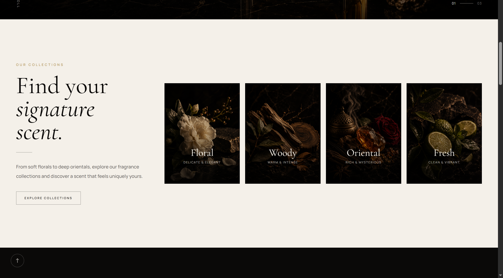

# Perfume Shop

A modern and responsive perfume e-commerce website built with React, Vite, and Tailwind CSS.

The project focuses on creating an elegant shopping experience with a clean interface, product collections, and a structured component-based architecture.

## Preview

<!-- Replace these placeholders with your actual screenshots -->


## Live Demo

<!-- Add your deployed website URL when available -->
Coming soon

## Features

- Modern and responsive user interface
- Reusable React components
- Hero section with product-focused visuals
- Perfume collections by fragrance category
- Best-selling products section
- Product data integration with Supabase
- Smooth animations and interactive UI elements
- Client-side navigation

## Perfume Collections

The website features different fragrance categories:

- Floral
- Woody
- Oriental
- Fresh

## Tech Stack

| Technology | Purpose |
|---|---|
| React 19 | UI development |
| Vite | Development and build tooling |
| Tailwind CSS 4 | Styling |
| React Router | Client-side routing |
| Supabase | Backend and product data |
| Motion | UI animations |
| Lucide React | Icons |

## Project Structure

```text
perfume-shop/
├── public/
├── src/
│   ├── assets/
│   ├── components/
│   ├── pages/
│   ├── lib/
│   │   └── supabase.js
│   ├── services/
│   │   └── productService.js
│   ├── App.jsx
│   └── main.jsx
├── .env.example
├── package.json
└── README.md
```

## Getting Started

### Prerequisites

- Node.js
- npm
- A Supabase project

### Installation

1. Clone the repository:

```bash
git clone https://github.com/melinahadi/perfume-shop.git
```

2. Navigate to the project directory:

```bash
cd perfume-shop
```

3. Install dependencies:

```bash
npm install
```

4. Configure environment variables.

Create a `.env` file in the root directory:

```env
VITE_SUPABASE_URL=your_supabase_url
VITE_SUPABASE_ANON_KEY=your_supabase_anon_key
```

5. Start the development server:

```bash
npm run dev
```

## Available Scripts

| Command | Description |
|---|---|
| `npm run dev` | Start development server |
| `npm run build` | Build for production |
| `npm run preview` | Preview production build |
| `npm run lint` | Run ESLint |

## Screenshots

### Homepage


### Collections


### Best Sellers


### Responsive Design


## What I Learned

Through this project, I gained practical experience in:

- Building reusable and maintainable React components
- Styling responsive interfaces with Tailwind CSS
- Integrating Supabase into a React application
- Organizing frontend services and application structure
- Working with modern frontend development tools

## Author

**Melina Hadi**

Front-End Developer

- GitHub: [@melinahadi](https://github.com/melinahadi)
- LinkedIn: [Melina Hadi](https://www.linkedin.com/in/melina-hadi-6a1959354/)
